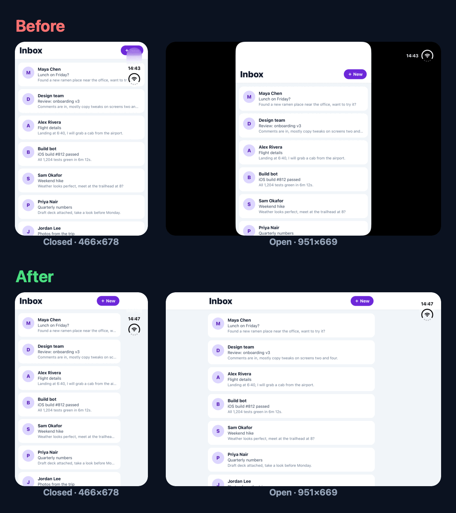

# iPhone Duo for React Native: Claude Code skills

Three [Claude Code](https://claude.com/claude-code) skills that get a React Native or Expo app ready for **iPhone Duo**, Apple's foldable (iOS 27.1). They chain **audit → fix → verify**.



<sub>The same Expo SDK 58 screen on the Xcode 27.1 iPhone Duo simulator (real screenshots). **Before:** `requireFullScreen: true` and a header padded only at the top. **After:** full screen off (the portrait lock stays), per-edge safe-area insets, and a 600 pt reading column.</sub>

## Install

In Claude Code:

```
/plugin marketplace add danielsamotys/claude-skills-iphone-duo
/plugin install iphone-duo-react-native@iphone-duo-react-native
```

Or try it for one session from a clone: `claude --plugin-dir /path/to/claude-skills-iphone-duo`.

Requirements: macOS with Xcode; Xcode 27.1+ (side by side is fine) for the real Duo pass; [Maestro](https://maestro.mobile.dev) and Java 17+ to drive the app; Accessibility access for your terminal so `duo-pose.sh` can click Device Hub's pose buttons.

## Three things we measured that you won't find in the docs

1. **An iOS 27 SDK build without the UIScene lifecycle crashes at launch**, in `__UIApplicationEvaluateRuntimeIssueForNoSceneLifecycleAdoption`, before any JS runs. Expo SDK 58's template already adopts scenes; bare React Native apps need a `SceneDelegate` ([recipe](skills/iphone-duo-adaptive-layout/references/native-ios.md)).
2. **Closed, the Duo's safe area is `{ top: 0, right: 84, bottom: 34, left: 0 }`.** The status bar moves into an 84 pt column on the right, so a header padded with `insets.top` alone draws its right-hand buttons under the clock (the "before" shots above). The open display has a right inset too.
3. **The black bars come from `UIRequiresFullScreen`, not from your portrait lock.** A portrait-only app that supports multitasking fills the unfolded display and stays portrait when closed. Only full screen keeps the lock on the inner display and letterboxes it. The fix is deleting one Info.plist key (Expo: don't set `ios.requireFullScreen`).

Also measured: `react-native-modal` with `avoidKeyboard` applies its `style` to two nested views, so inset padding passed there counts twice. And Split View leaves a *visible* app `inactive`.

## The three skills

| Skill | Ask Claude… | What it does |
|---|---|---|
| `iphone-duo-readiness` | "Is the app Duo-ready?" | Runs a read-only audit script (SDK and CI toolchain, UIScene, orientation lock, stale `Dimensions.get`, notch heuristics, top-only safe-area insets, AppState gates) and writes a ranked report |
| `iphone-duo-adaptive-layout` | "Make this screen work on the foldable" | The fix recipes: one width hook, a decision order for stale size reads, wide-layout rules, per-edge insets (including a `react-native-modal` double-padding trap), the native UIScene + orientation changes, and AppState in Split View |
| `iphone-duo-verify` | "Verify it on the Duo simulator" | Gates on Xcode 27.1, drives Device Hub poses (closed / open / rotate / fold-on-the-same-screen), takes per-display screenshots with logical sizes, uses Maestro on the closed display, and falls back to a labeled iPad proxy |


**Sample output:** [a full readiness report](docs/sample-audit-report.md) for the open-source Bluesky app. It covers SDK and CI blockers, stale size reads with `file:line`, header buttons under the 84 pt column, and AppState gates that pause a visible Split View window.

## Why the Duo breaks React Native apps

- **The window resizes at runtime.** Fold, unfold, rotation and Split View change its width with no relaunch. Any `Dimensions.get()` captured once is wrong after the first fold.
- **Insets are asymmetric.** Closed, the Duo reserves an 84 pt column on the **right** (`{ top: 0, right: 84, bottom: 34, left: 0 }`, measured). Headers that pad only `insets.top` put buttons inside it.
- **`UIRequiresFullScreen` letterboxes the inner display** (a phone-shaped window with black bars), and so does any build with an SDK older than iOS 27.1.
- **iOS 27 SDK builds trap at launch without the UIScene lifecycle**, and Xcode 27 fails pods targeting iOS < 15.
- **Split View leaves a visible app `inactive`**, so "pause when not active" logic pauses on-screen content.

Every number in these skills was measured on the Xcode 27.1 Duo simulator, or is marked as a third-party claim. The measurements were taken against a production bare React Native 0.83 app and a blank Expo SDK 58 app. The audit was also run on Expo SDK 57 apps (expo-router, monorepo). Sources are in `skills/iphone-duo-adaptive-layout/references/iphone-duo-facts.md`.

## What's in it

```
skills/
  iphone-duo-readiness/        SKILL.md, scripts/audit.sh (bash audit.sh <app-dir>; works for bare RN, Expo, monorepos)
  iphone-duo-adaptive-layout/  SKILL.md, references/iphone-duo-facts.md, references/native-ios.md
  iphone-duo-verify/           SKILL.md, scripts/duo-pose.sh (Device Hub poses + per-display shots),
                               scripts/open-drawer-item.yaml (composable Maestro step for React Navigation drawers)
```

## Limits

- Every measurement is from the Xcode 27.1 simulator, not a physical iPhone Duo. Hardware may differ.
- Split View can't be reached on the Xcode 27.1 simulator; it needs a device.
- Hinge-angle and posture APIs have no React Native binding yet; the skills don't cover them.
- Expo SDK ≤ 57 needs the SDK 58 upgrade for UIScene; there's no plugin for older SDKs.

## License

MIT. See [LICENSE](LICENSE).
